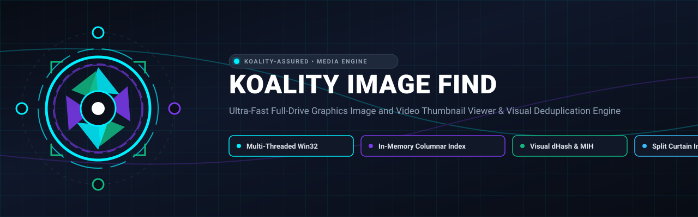
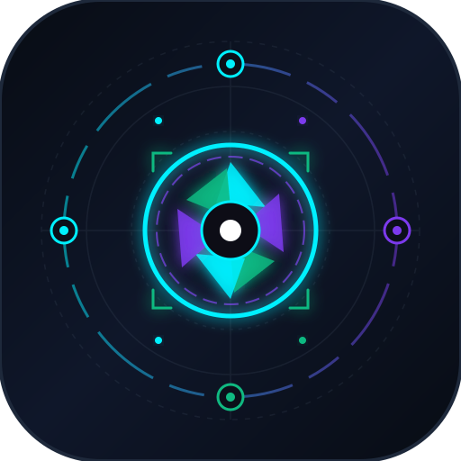

<div align="center">



# Koality Image Find

<p align="center">
  
</p>

**Ultra-Fast Full-Drive Graphics Image and Video Thumbnail Viewer & Visual Deduplication Engine**

[](https://github.com/Koality-Assured/koality-image-find/actions/workflows/ci.yml)
[](LICENSE)
[-00ADD8.svg)](go.mod)
[](#)
[](https://conventionalcommits.org)

</div>

---

**koality-image-find** is a high-performance Windows full-drive graphics image and video thumbnail viewer engineered to index, search, visually browse, and deduplicate hundreds of thousands of media files across local SSDs, HDDs, SD cards, and network shares in seconds.

---

## Key Features

- **Ultra-Fast Non-Elevated Traversal**: Multi-threaded Win32 `FindFirstFileExW` (`FindExInfoBasic` + `FIND_FIRST_EX_LARGE_FETCH`) scans 500,000+ files in seconds without requiring UAC administrator privileges.
- **Cloud Reparse Point Protection**: Safely detects and skips OneDrive, iCloud, and Dropbox placeholders (`IO_REPARSE_TAG_CLOUD_*`, `FILE_ATTRIBUTE_OFFLINE`) to prevent accidental, bandwidth-exhausting cloud downloads.
- **Junction & Loop Safe**: Avoids recursive directory junctions and symbolic link loops.
- **Sub-8ms Columnar Search**: Compact 32-byte in-memory records index 500,000 files in ~16MB RAM with parallel substring search across all CPU cores.
- **Visual Deduplication & Similarity Engine**:
  - **64-bit Gradient Hash (`dHash`)**: Resilient to aspect ratio shifts, minor compression artifacts, and color balance variations.
  - **Multi-Index Hashing (MIH)**: 4x16-bit blocks for sublinear nearest-neighbor lookup across tens of thousands of media files.
  - **Disjoint Set Union (DSU) Clustering**: Groups visual duplicates into connected clusters with path compression and rank union.
  - **Deterministic Keeper Selection**: Automatically recommends keepers prioritizing highest resolution, file size, and oldest capture date.
- **📸 Personal Media Preset**: Single-click bitwise filter to isolate camera/phone photography and home videos (`.jpg`, `.png`, `.heic`, `.mp4`, `.mov`, etc.), omitting developer sprites, OS icons, and textures.
- **Interactive Split Curtain Comparison**:
  - **Curtain Split Slider**: Draggable center divider comparing keeper vs. duplicate at identical canvas coordinates.
  - **Side-by-Side Dual View**: Simultaneous metadata comparison (dimensions, file size, timestamps, full path).
  - **Spacebar Blink Diff**: Instant key toggle to reveal subtle compression artifacts, watermarks, or burst variations.
- **Multi-Tier Thumbnail Engine**:
  - **Tier 1 (Instant EXIF IFD1)**: Extracts pre-rendered embedded camera thumbnails in <0.3ms from the first 64KB APP1 header.
  - **Tier 2 (Pure Go Scaled Decoding)**: Scaled decoding with decompression bomb protection.
  - **Tier 3 (Windows Shell COM Pool)**: Thread-pinned Single-Threaded Apartment (STA) workers with an active Win32 message pump for native image (RAW, PSD, HEIC) and video (MP4, MOV, WMV, AVI) extraction via `IShellItemImageFactory`.
  - **Video Fallback**: Automatic discovery and streaming pipe invocation of FFmpeg for exotic containers (`.mkv`, `.webm`, `.flv`).
- **NTFS-Friendly `bbolt` Cache**: Memory-mapped key-value store prevents NTFS `$MFT` directory fragmentation and 4KB cluster slack space waste, atomically caching thumbnail bytes and 64-bit dHashes.
- **60+ FPS Virtual Grid**: Pure mathematical $O(1)$ virtual grid mounting only the visible 60–80 cards in the viewport.
- **Zero-Dependency Static Binary**: Compiles to a single standalone Windows executable (`koality-image-find.exe`) with `CGO_ENABLED=0` and embeds all frontend assets via `//go:embed`.
- **Authenticated Loopback API**: 256-bit cryptographically secure session tokens prevent unauthorized cross-origin access from external browsers.

---

## Architecture Overview

```text
┌─────────────────────────────────────────────────────────────────────────────┐
│                       DESKTOP FRONTEND (WebView2 / Edge)                    │
│  - Mathematical O(1) Virtual Grid (~80 visible DOM cards)                   │
│  - Mode Switch: [🖼️ Browse Grid] vs [🥞 Duplicates & Similar]              │
│  - Split Curtain Slider, Side-by-Side View & Spacebar Blink Diff            │
│  - Instant Search (<10ms debounce) & [📸 Personal Media] Preset Filter      │
└──────────────────────────────────────┬──────────────────────────────────────┘
                                       │ Authenticated Loopback (Token Header)
┌──────────────────────────────────────▼──────────────────────────────────────┐
│                            GO BACKEND (Pure Go, Win32)                      │
│                                                                             │
│  ┌───────────────────────┐              ┌─────────────────────────────────┐ │
│  │   Scanner Engine      │              │         In-Memory Index         │ │
│  │ - FindFirstFileExW    │              │ - 36-byte ItemRecord            │ │
│  │ - Cloud Filter        │─────────────►│ - Packed String Store           │ │
│  │ - Junction Prevention │              │ - Parallel Search & Sort        │ │
│  └───────────────────────┘              │ - Bitwise Personal Media Filter │ │
│                                         └────────────────┬────────────────┘ │
│                                                          │                  │
│  ┌───────────────────────────────────────────────────────▼────────────────┐ │
│  │                     Multi-Tier Thumbnail Pipeline                      │ │
│  │  [Tier 1: EXIF IFD1] ──► [Tier 2: Pure-Go Scaled]                     │ │
│  │  [Tier 3: Win32 STA Shell COM] ──► [FFmpeg Streaming Pipe]             │ │
│  └───────────────────────────────────────┬────────────────────────────────┘ │
│                                          │                                  │
│  ┌───────────────────────────────────────▼────────────────────────────────┐ │
│  │                   Visual Deduplication & Similarity                    │ │
│  │  - 64-bit Gradient Hash (dHash) & Hamming Distance                     │ │
│  │  - Multi-Index Hashing (MIH) 4x16-bit Sublinear Search                 │ │
│  │  - Disjoint Set Union (DSU) Transitive Clustering                      │ │
│  │  - Deterministic Keeper Ranking & Potential Reclaim Calculation        │ │
│  └───────────────────────────────────────┬────────────────────────────────┘ │
│                                          │                                  │
│  ┌───────────────────────────────────────▼────────────────────────────────┐ │
│  │                   Cache Layer: bbolt Memory-Mapped KV                  │ │
│  │  Key: SHA256(Path + Size + ModTime) ──► Value: JPEG Thumbnail + dHash  │ │
│  └────────────────────────────────────────────────────────────────────────┘ │
└─────────────────────────────────────────────────────────────────────────────┘
```

---

## Quick Start

### Prerequisites
- Windows 10 or Windows 11 (64-bit)
- Go 1.23+ (for building from source)
- Google Chrome or Microsoft Edge (for desktop app mode)

### Building from Source

```powershell
git clone https://github.com/Koality-Assured/koality-image-find.git
cd koality-image-find
$env:CGO_ENABLED="0"
go build -ldflags="-s -w" -o koality-image-find.exe ./cmd/koality-image-find
```

### Running

```powershell
# Launch with default auto-detection (scans user profile and common picture/video folders)
.\koality-image-find.exe

# Or specify specific root drives or directories:
.\koality-image-find.exe -roots "C:\"
.\koality-image-find.exe -roots "C:\Users\Robbie\Pictures,D:\CameraRoll"
```

---

## Supported Formats

- **Graphics Images**: JPEG (`.jpg`, `.jpeg`), PNG (`.png`), GIF (`.gif`), WebP (`.webp`), Bitmap (`.bmp`), TIFF (`.tiff`, `.tif`), SVG (`.svg`), Icon (`.ico`), AVIF (`.avif`), HEIC/HEIF (`.heic`, `.heif`), Photoshop (`.psd`), Camera RAW (`.raw`, `.cr2`, `.nef`, `.arw`, `.dng`, `.orf`, `.rw2`).
- **Videos**: MP4 (`.mp4`), Matroska (`.mkv`), QuickTime (`.mov`), AVI (`.avi`), WebM (`.webm`), Windows Media (`.wmv`), Flash Video (`.flv`), MPEG Transport Stream (`.ts`, `.mts`), 3GP (`.3gp`).

---

## Security Model

- **Localhost Loopback Isolation**: Binds strictly to `127.0.0.1`.
- **Cryptographic Session Tokens**: Every launch generates a cryptographically random 256-bit token passed to the client interface. All REST and thumbnail endpoints require and verify the session token.
- **Path Whitelisting**: Thumbnail and desktop revelation endpoints only accept file paths that exist in the active verified index.
- **Safe Desktop Actions**: Uses Win32 `SHOpenFolderAndSelectItems` and `ShellExecuteExW` instead of invoking arbitrary command-line strings.

---

## License

Licensed under the [MIT License](LICENSE).
